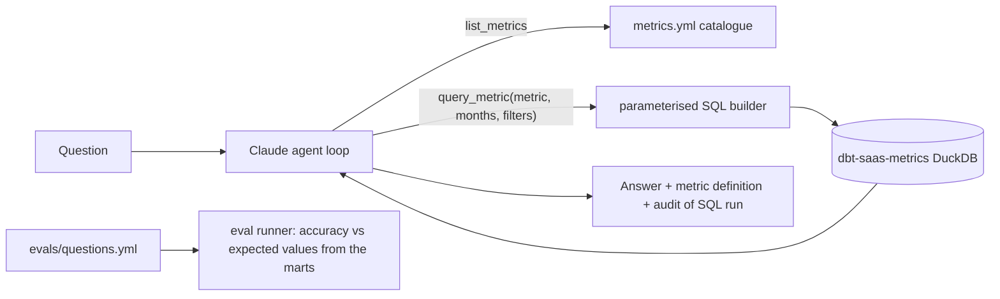

# Semantic-Layer AI Agent

[](https://github.com/Saigwe/semantic-layer-ai-agent/actions/workflows/ci.yml)
 

A Claude agent that answers business questions ("What was net new MRR in June?", "How many enterprise accounts are active?") **only through governed metrics** defined on top of the tested dbt marts in [dbt-saas-metrics](https://github.com/Saigwe/dbt-saas-metrics). It never writes SQL itself.



## Why restrict the agent to a catalogue?

Letting a model write free-form SQL against raw tables gives fluent answers that nobody can verify, and definitions drift from finance's numbers. Here:

- **The catalogue is the semantic layer.** [`metrics.yml`](metrics.yml) defines 8 metrics, each mapped to a tested mart, with a definition, grain and allowed filters.
- **The model chooses, the code builds.** Claude picks a metric name and parameters. Table names and expressions come from the catalogue, and every value is a bound parameter, so SQL injection isn't possible (there's a test for it).
- **Strict tool schemas** (`strict: true`, `additionalProperties: false`) keep tool inputs valid. Bad inputs come back to Claude as `is_error` tool results it can correct, instead of crashing.
- **Every answer is auditable.** The agent returns the SQL and parameters it ran alongside the answer.
- **Out-of-scope questions** ("customer acquisition cost?") get a fixed refusal phrase plus the list of available metrics, rather than a guess.

## Evaluation

[`evals/questions.yml`](evals/questions.yml) has 12 questions: 10 answerable (single months, ranges, filters, and a quarter total that needs summing) and 2 out-of-scope. Expected values are computed **directly from the marts with SQL**, never from the agent. The runner checks that the expected figure appears in the answer, or that the refusal phrase does.

```bash
python -m evals.run_evals            # one agent run per question (uses API credits)
```

Results are written to `output/eval_results.json`.

> **Status:** the tools, SQL builder, agent loop (with a fake client) and eval grading are all tested. The live agent and eval run need Anthropic API credentials and haven't been run yet, so add your accuracy figure here after the first run.

## Run it

```bash
pip install -r requirements.txt
# build the dbt project first (dbt-saas-metrics: dbt build), or set AGENT_DB_PATH to its target/saas.duckdb
export ANTHROPIC_API_KEY=...          # or `ant auth login`
python -m agent.agent "What was net new MRR in June 2026?"
pytest
```

## Implementation notes

- **Model:** `claude-opus-5-5` at `medium` effort, with server-side refusal fallback enabled.
- **Explicit tool-use loop** instead of the SDK's beta tool runner, so every query lands in the audit trail and the loop can be unit-tested. The full assistant content is appended each turn, so thinking and tool blocks stay valid.
- **Tool results:** all results for a turn go back in one user message, and the loop is capped at 8 turns.

## Walkthrough

- [ ] 3-minute Loom walkthrough ([script ready](docs/walkthrough.md))

## Stack

Python, Anthropic SDK (tool use), DuckDB, dbt marts, YAML catalogue, pytest.
